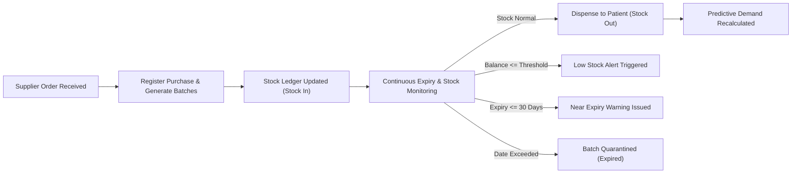

# Pharmacy Stock & Expiry Monitor (PSEM)

An enterprise-grade pharmaceutical inventory management, batch expiry tracking, and regulatory compliance platform. Designed for modern pharmacies, hospital dispensaries, and distribution centers, the system delivers real-time stock visibility, automated expiry tracking, auditable stock ledger movements, and predictive consumption forecasting.

---

## 📑 Table of Contents

- [Executive Summary](#-executive-summary)
- [Core Functional Modules](#-core-functional-modules)
  - [1. Medicine Catalog & Inventory Control](#1-medicine-catalog--inventory-control)
  - [2. Batch Lifecycle & FEFO Management](#2-batch-lifecycle--fefo-management)
  - [3. Audited Stock Ledger](#3-audited-stock-ledger)
  - [4. Procurement & Supplier Relations](#4-procurement--supplier-relations)
  - [5. Automated Alerting & Monitoring Engine](#5-automated-alerting--monitoring-engine)
  - [6. Predictive Demand & Runout Analytics](#6-predictive-demand--runout-analytics)
  - [7. Executive Analytics Dashboard](#7-executive-analytics-dashboard)
- [Role-Based Access Control (RBAC)](#-role-based-access-control-rbac)
- [Operational Workflow](#-operational-workflow)
- [Data Security & Compliance](#-data-security--compliance)
- [Application Deployment & Run Guide](#-application-deployment--run-guide)
- [License](#-license)

---

## 💼 Executive Summary

Managing pharmaceutical inventories requires uncompromising accuracy, strict regulatory adherence, and proactive expiry oversight. **Pharmacy Stock & Expiry Monitor** mitigates the clinical and financial risks associated with medicine expiration, stockouts, and manual discrepancy tracking through:

* **Automated Expiry Safeguards**: Eliminates dispensing expired or compromised medication through batch-level tracking.
* **First-Expired, First-Out (FEFO) Optimization**: Prioritizes utilization of batches nearing expiration to minimize product wastage.
* **Complete Chain of Custody**: Enforces a ledger for all inventory adjustments, receipts, and dispensations.
* **Predictive Runout Forecasting**: Empowers pharmacy managers with algorithmic consumption forecasts before critical shortages occur.

---

## 🔬 Core Functional Modules

### 1. Medicine Catalog & Inventory Control
* **Master Formulary Directory**: Central repository for medication profiles including custom Medicine Codes, Generic Names, Categories, and Manufacturers.
* **Automated Aggregate Stocking**: Real-time aggregation of active batch balances to compute live on-hand quantities.
* **Safety Reorder Thresholds**: Per-medicine minimum stock levels with automated notifications when balances reach critical points.
* **Data Lifecycle Protection**: Soft-deletion safeguards ensuring historical reporting and ledger trails remain intact.

### 2. Batch Lifecycle & FEFO Management
* **Granular Batch Tracking**: Full visibility into individual lots, including Batch Numbers, Manufacturing Dates, Expiry Dates, Received Quantities, and Remaining Stock.
* **Expiry Velocity Tracking**: Dynamic countdown of days remaining until expiration across all active batches.
* **Quarantine Readiness**: Automatic status transitions for expired batches to immediately prevent selection during dispensing.

### 3. Audited Stock Ledger
* **Movement Classification**: Categorized logging for every stock movement:
  * `Stock In` — Vendor deliveries, batch intakes, and returns.
  * `Stock Out` — Prescriptions dispensed and customer sales.
  * `Adjustment` — Inventory count reconciliations, damaged goods write-offs, and audit corrections.
  * `Transfer` — Internal distribution between dispensary stations or storage rooms.
* **Accountability Attribution**: Captures user details, transaction reason, exact quantities, and timestamps for every entry.

### 4. Procurement & Supplier Relations
* **Vendor Directory**: Supplier directory managing contact persons, communications, and commercial addresses.
* **Purchase Order Lifecycle**: Multi-item purchase receipts linking invoice numbers, purchase dates, and financial totals.
* **Line-Item Reconciliation**: Purchase entries generate corresponding batch records and automatically update current inventory.

### 5. Automated Alerting & Monitoring Engine
* **Proactive Expiry Lookahead**: Flags batches entering a 30-day expiry window (`Near Expiry`).
* **Critical Expiration Enforcement**: Immediate escalation and notification upon a batch reaching its expiry date (`Expired`).
* **Depletion Warnings**: Instant triggers when current inventory drops to or below configured reorder levels (`Low Stock`).
* **Workflow Management**: Direct interface tools for marking notifications as read or resolving documented issues.

### 6. Predictive Demand & Runout Analytics
* **Consumption Velocity Calculation**: Analyzes historical dispensing transactions to measure Average Daily Consumption ($\text{Units} / \text{Day}$).
* **Estimated Runout Horizon**: Calculates remaining shelf-life days and projected stockout dates:
  $$\text{Days Remaining} = \frac{\text{Current Stock Units}}{\text{Average Daily Consumption Velocity}}$$
* **Stockout Risk Scoring**: Evaluates inventory levels against consumption speed to classify medicines into Low, Medium, or High Risk tiers.

### 7. Executive Analytics Dashboard
* **High-Level KPI Overview**: Real-time cards displaying Total Medicines, Active Batches, Registered Suppliers, and Unresolved Alerts.
* **Inventory Valuation**: Financial computation of total inventory capitalization based on active batch unit costs.
* **Movement Visualizations**: Periodic timeline charts breaking down inventory intake, dispensing patterns, and corrective adjustments.

---

## 👥 Role-Based Access Control (RBAC)

The system enforces role separation to preserve operational integrity across dispensary personnel:

| Role | Operational Scope | Core Capabilities |
| :--- | :--- | :--- |
| **System Administrator** | Full Governance & Security | User administration, system settings, category maintenance, inventory deletion, and audit oversight. |
| **Store Manager** | Procurement & Operations | Purchase order creation, supplier management, batch receiving, stock adjustments, and inventory analytics. |
| **Pharmacist** | Dispensing & Patient Care | Prescription dispensing, batch selection, real-time stock lookups, expiry review, and alert monitoring. |

---

## 🔄 Operational Workflow



---

## 🛡 Data Security & Compliance

* **Access Control**: Role-based interface restrictions and protected application routes.
* **Data Retention**: Preserves relational integrity using soft deletes across all inventory tables.
* **Traceability**: Audit tracking on sensitive actions, documenting the initiator, timestamp, and modification details.
* **Session Handling**: Token-based session management ensuring secure, authenticated operational sessions.

---

## 💻 Application Deployment & Run Guide

### Prerequisites
* **Node.js**: Version 18.0 or newer
* **Package Manager**: npm, yarn, or pnpm

### Step-by-Step Installation

1. **Clone the Project Repository**:
   ```bash
   git clone <repository-name>
   cd <repository-directory>
   ```

2. **Navigate to the Application Directory**:
   ```bash
   cd pharmacyfrontend
   ```

3. **Install Dependencies**:
   ```bash
   npm install
   ```

4. **Build the Application**:
   ```bash
   npm run build
   ```

5. **Start the Local Application Server**:
   ```bash
   npm run dev
   ```

---

## 📄 License

This project is released under the [MIT License](LICENSE).
